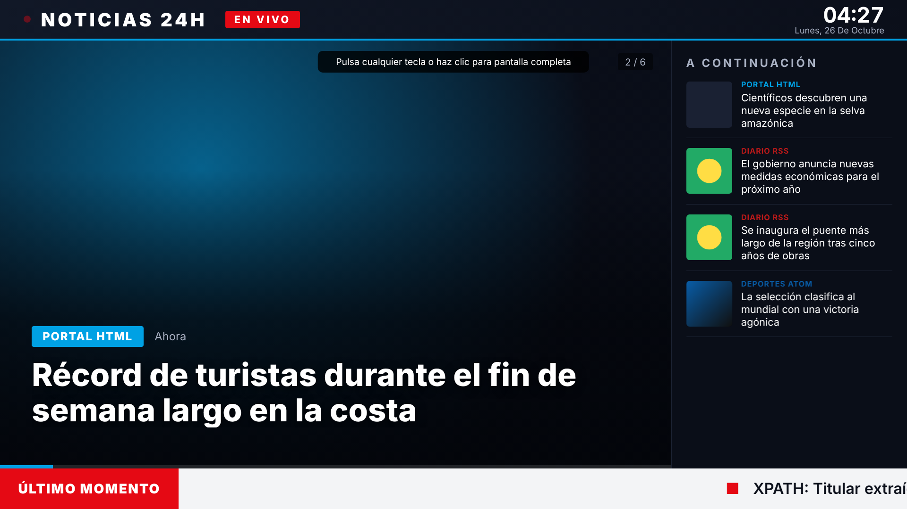

# Noticias TV

Recopila noticias de los sitios web que elijas (feeds RSS/Atom o páginas HTML), las guarda en MySQL
y las muestra en una pantalla con estilo de canal de noticias: titular grande con foto, lista
"A continuación", reloj y zócalo de "Último momento" que se desplaza.



Hecho con PHP 8, MySQL/MariaDB, HTML, CSS y JavaScript, sin dependencias externas.

## Archivos

| Archivo | Para qué sirve |
|---|---|
| `schema.sql` | Crea la base `noticias_tv`, las tablas `fuentes` y `noticias`, y carga 4 fuentes de ejemplo |
| `config.php` | Configuración: base de datos, contraseña, tiempos de la pantalla |
| `recolectar.php` | Recolector. Se ejecuta por cron (o por web con token) |
| `lib/recolector.php` | Descarga y extracción: RSS 2.0, RSS 1.0, Atom, HTML con detección automática o XPath |
| `api.php` | Devuelve las últimas noticias en JSON para la pantalla |
| `index.php` + `assets/tv.*` | La pantalla de TV |
| `admin.php` | Panel para añadir, editar, probar, activar o borrar fuentes |

## Instalación

1. Copia la carpeta `noticias-tv/` a tu servidor web (Apache/Nginx con PHP 8 y las extensiones
   `pdo_mysql`, `curl`, `dom`, `simplexml` y `mbstring`).
2. Crea la base de datos:
   ```bash
   mysql -u root -p < schema.sql
   ```
3. Crea `config.local.php` con tus datos (así no se pisan al actualizar):
   ```php
   <?php
   $CFG['db_user']    = 'noticias';
   $CFG['db_pass']    = 'tu-clave';
   $CFG['admin_pass'] = 'una-clave-segura';
   $CFG['cron_token'] = 'un-token-largo-al-azar';
   $CFG['titulo_canal'] = 'MI CANAL';
   ```
4. Programa el recolector cada 10 minutos (`crontab -e`):
   ```
   */10 * * * * php /var/www/noticias-tv/recolectar.php >> /var/log/noticias-tv.log 2>&1
   ```
   Si tu hosting no tiene cron, llama a esta URL desde un servicio externo de cron:
   `https://tu-sitio/noticias-tv/recolectar.php?token=TU_TOKEN`
5. Abre `admin.php`, revisa las fuentes y pulsa **Recolectar todas ahora**.
6. En el televisor, abre `index.php` en el navegador y haz clic (o pulsa una tecla) para ponerlo
   a pantalla completa.

## Añadir sitios web

En `admin.php` → **Añadir fuente**:

- **Automático** (recomendado): si la URL es un feed lo lee directamente. Si es una página HTML,
  busca el feed RSS que anuncia en su `<head>`. Si no tiene, extrae los titulares de los
  `<article>` o de los `<h1>`–`<h3>` con enlace.
- **RSS / Atom**: fuerza la lectura como feed.
- **Página HTML (XPath)**: para sitios sin RSS con estructura propia. Ejemplo:
  - Elemento: `//div[contains(@class,"nota")]`
  - Título: `.//h2` · Enlace: `.//a/@href` · Imagen: `.//img/@src`

El botón **Probar sin guardar** muestra lo que se obtendría, para ajustar la configuración antes
de guardarla.

Respeta los términos de uso de cada sitio: siempre que puedas usa su feed RSS oficial.

## Pantalla

- `index.php?fuentes=1,3` muestra solo algunas fuentes (útil para varias pantallas temáticas).
- Flechas ← → del teclado: noticia anterior o siguiente.
- La pantalla pide noticias nuevas cada `refresco_minutos` y se recarga sola cada 6 horas, así
  puede estar encendida 24/7.
- Se adapta a pantallas verticales (tótems).
- Cada fuente tiene su color, que se aplica a la etiqueta y a la barra de progreso.

Las noticias con más de `dias_conservar` días se borran solas.
